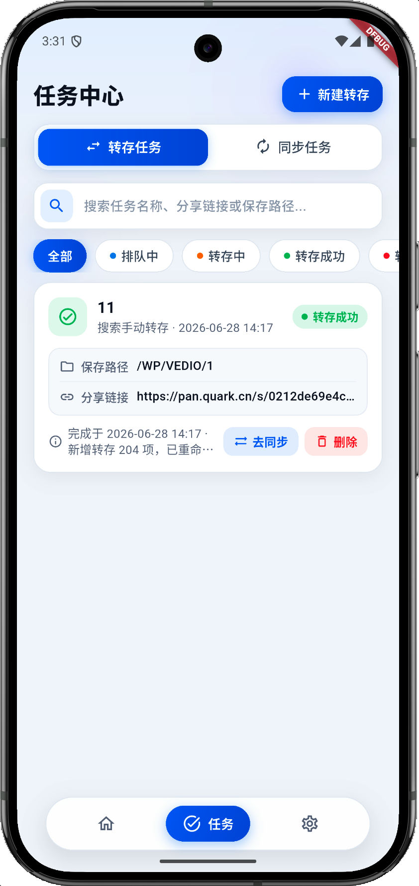
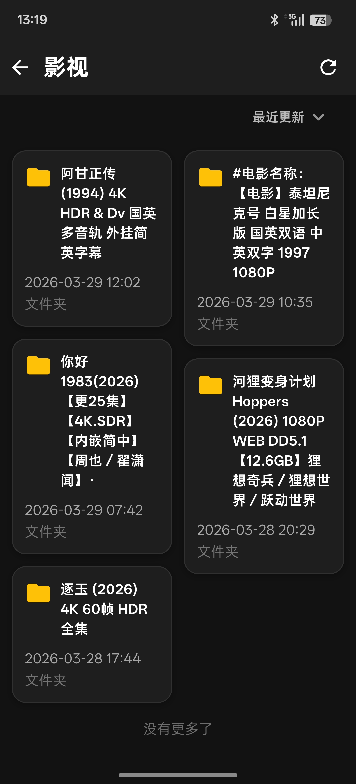
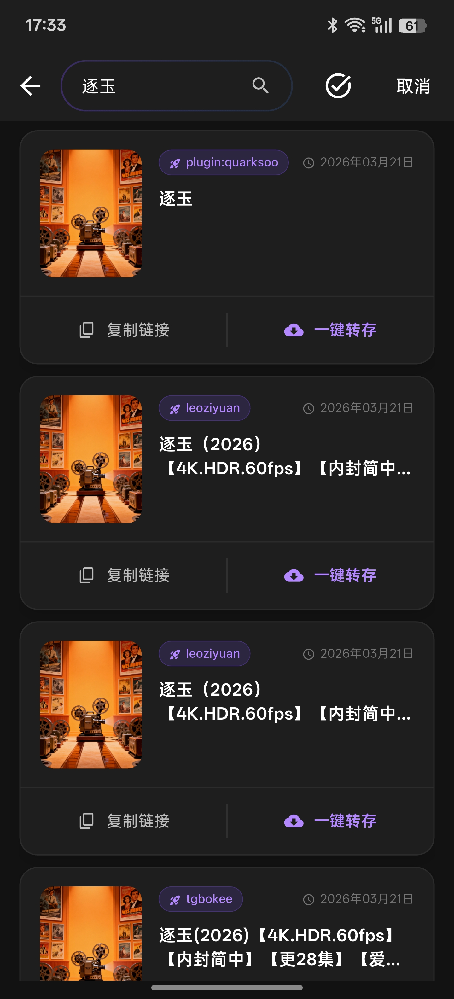
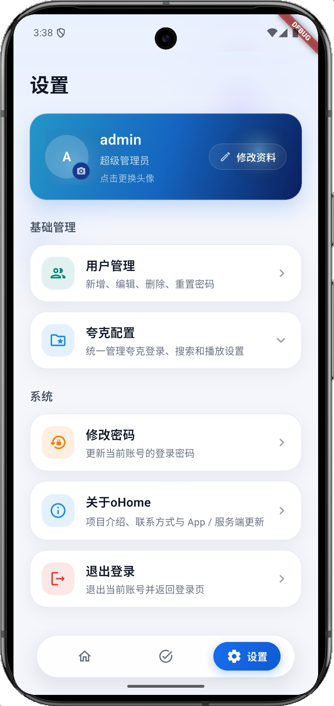
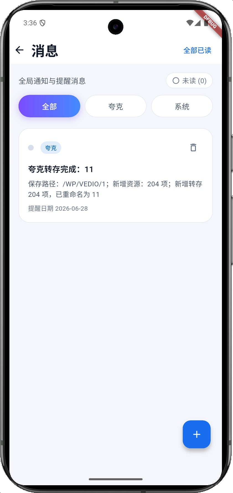

# ohome

`ohome` 是一个以夸克网盘为资源底座，把影视、短剧、播客、有声书和电子书整理到同一个 App 中，并围绕资源发现、搜索转存、播放阅读和消息提醒提供完整体验。

## 功能概览

### 首页与资源发现

- 影视、短剧、播客、阅读四个快捷入口
- 热门推荐：豆瓣实时榜单（电影、电视剧）、红果短剧榜单、懒人听书榜单
- 榜单支持分页加载，点击条目可直接联动全网资源搜索
- 搜索资源、消息提醒和播放历史一屏直达
- 首页历史记录浮层支持断点续播和查看播放列表

### 家庭影音资源中心

- 影视、短剧、播客 / 有声书等资源浏览与在线播放
- 基于夸克网盘文件流播放，支持 302 直连和本地代理
- 视频播放器支持全屏、倍速、字幕、音轨、跳过片头片尾和投屏
- 短剧播放器支持选集、连续播放和手势控制
- 播客 / 有声书音频播放，支持后台播放、定时关闭和断点续播
- EPUB / TXT / PDF 电子书阅读，保留阅读进度
- 播放历史记录与首页最近观看回显

### 资源搜索与任务中心

- 基于 pansou 的网盘资源聚合搜索
- 搜索结果支持复制分享链接、一键转存
- 手动转存支持填写分享链接、提取码和保存路径
- 任务中心统一管理转存任务与同步任务
- 支持任务搜索、状态筛选、执行详情、去同步和删除
- 自动转存 / 定时同步，支持每天、每周规则
- 转存 / 同步完成后推送站内消息

### 夸克网盘能力

- 夸克 Cookie / TV 扫码登录
- 夸克目录配置管理
- 网盘文件浏览、重命名、移动、上传、删除、流式播放
- 支持夸克 302 播放
- 夸克资源搜索

### 消息与账号

- 站内消息中心：全部 / 夸克 / 系统分类
- 未读筛选、全部已读、消息删除
- WebSocket 实时推送，转存 / 同步结果及时通知
- 多用户与超级管理员权限
- 用户管理、头像 / 资料修改、密码修改
- App 与服务端在线检查更新

## 快速上手

1. 先启动服务端
2. 再安装 Android 客户端
3. 在客户端登录页通过局域网发现或手动输入服务端地址完成连接


> 视频录制于早期版本，部分界面和功能已经调整，请以当前版本为准。

## 服务端

#### 快速启动（docker run）

```bash
mkdir -p /opt/ohome/conf /opt/ohome/data /opt/ohome/log 

docker run -d --name ohome-server --restart unless-stopped -p 18090:18090  --add-host host.docker.internal:host-gateway -v /opt/ohome/conf:/app/conf -v /opt/ohome/data:/app/data -v /opt/ohome/log:/app/log hanlinwang0606/ohome:runtime-v2026.11.03  
```

#### 独立运行包（Windows / macOS / Linux）

从 [releases](https://github.com/leftScience/ohome/releases) 下载对应平台的独立运行包并解压，目录中会自带：

- `launcher[.exe]`
- `bin/server[.exe]`
- `conf/config.yaml`
- `sql/init_data.sql`

首次启动请运行 `launcher`（不要直接运行 `server`），后续 App 可通过“关于oHome”页触发后端拉取最新二进制并自动重启服务。

### 服务端数据持久化

服务端部署时，下面几个目录最重要：

- [`/opt/ohome/conf/config.yaml`](./end/conf/config.yaml)：运行配置
- [`/opt/ohome/data`](./end/data)：数据库和实例标识
- [`/opt/ohome/log`](./end/log)：日志文件

建议定期备份

## 客户端

### 下载地址见 Releases

[Releases](https://github.com/leftScience/ohome/releases)

### 客户端适合做什么

客户端是 Flutter 应用，当前主要面向 Android 使用，负责登录、资源发现、播放阅读、网盘管理、任务中心和消息提醒等交互能力。

### 默认超级管理员账号密码

```
admin/123
```

#### 首页与任务中心

<table>
  <tr>
    <td align="center">
      
      <br />
      首页：热门推荐、快捷入口与播放历史
    </td>
    <td align="center">
      
      <br />
      任务中心：转存任务与同步任务
    </td>
  </tr>
</table>

#### 资源与设置

<table>
  <tr>
    <td align="center">
      
      <br />
      影视资源库
    </td>
    <td align="center">
      
      <br />
      资源搜索与一键转存
    </td>
    <td align="center">
      
      <br />
      设置界面
    </td>
  </tr>
</table>

#### 播放体验

<table>
  <tr>
    <td align="center">
      
      <br />
      短剧播放
    </td>
    <td align="center">
      
      <br />
      影视播放可全屏
    </td>
    <td align="center">
      
      <br />
      音频播放
    </td>
  </tr>
  <tr>
    <td align="center">
      
      <br />
      有声书播放
    </td>
    <td></td>
    <td></td>
  </tr>
</table>

#### 消息提醒

<table>
  <tr>
    <td align="center">
      
      <br />
      消息中心
    </td>
  </tr>
</table>

### 客户端如何连接服务端

客户端和服务端配合使用，推荐连接顺序如下：

1. 先确认服务端已经启动
2. 手机和服务端尽量处于同一局域网
3. 在客户端登录页优先使用局域网发现
4. 如果自动发现失败，手动输入服务端地址，例如 `http://192.168.1.10:18090`

## 参考项目

本项目在设计和实现过程中参考了以下开源项目：

- [fish2018/pansou](https://github.com/fish2018/pansou)
- [OpenListTeam/OpenList](https://github.com/OpenListTeam/OpenList)
- [Cp0204/quark-auto-save](https://github.com/Cp0204/quark-auto-save)

## 免责声明

本项目为个人兴趣开发，旨在通过程序自动化提高网盘使用效率。

程序没有任何破解行为，只是对于夸克已有的 API 进行封装，所有数据来自于夸克官方 API；本人不对网盘内容负责，不对夸克官方 API 未来可能的变动导致的影响负责，请自行斟酌使用。

源码公开仅供学习与交流使用，未授权商业使用，严禁用于非法用途。
